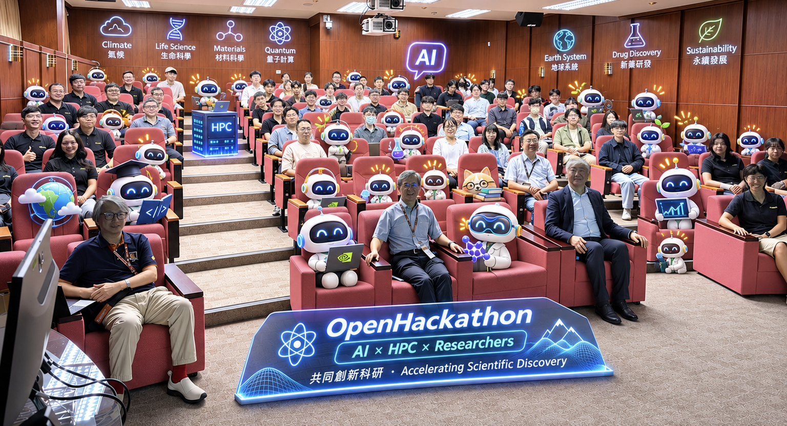

# NCHC Open Hackathon 2026

由國研院國網中心與 NVIDIA 共同主辦的 NCHC Open Hackathon 2026，匯集 16 隊在高效能計算、量子運算、DPU、生醫與跨域 AI 的研究成果。本頁收錄本年度各隊期末報告、成果總表、活動證明、活動簡報與錄影。

  

## 活動錄影與簡報

[觀看活動完整錄影（YouTube，不公開列出/Unlisted）](https://youtu.be/w42k0eUZ-w8)

| 場次/資料 | 日期 | PDF |
| --------- | :--: | --- |
| Day 0：Kick-off Meeting | 2026-10-14 | [活動簡報](slides/Day%200.pdf) |
| Day 1：Scrum #1 | 2026-10-21 | [活動簡報](slides/Day%201.pdf) |
| Day 2：Scrum #2 | 2026-10-28 | [活動簡報](slides/Day%202.pdf) |
| Final Day：期末成果發表 | 2026-11-04 | [活動簡報](slides/Day%20Fianl.pdf) |
| NCHC &times; NVIDIA 七年 Open Hackathon 回顧 | - | [七年回顧](NCHC-NVIDIA-7year-OpenHackathon-Review.pdf) |

## 活動證明

16 組活動證明統一收錄於[活動證明資料夾](certificates/)，每份 PDF 依下方成果表的隊伍編號命名。

## 2026 年各隊期末成果

以下依本次提供的 16 份 `day_final` 報告整理，採用檔案內的最新成果，包含 NTU SPML 標示 2026-11-05 的更新內容。每列均可連至完整 PDF；原有 PDF 保留原檔，10 份 PPTX 已轉為 PDF，並納入原簡報的隱藏頁與附錄。

數據均為各隊報告所載，並非本頁重新執行的效能測試。**工作負載加速**與 **AI 協作開發/研究流程加速**分開列示；硬體、GPU 數量、演算法、資料集與計時範圍不同的倍率不可直接相比或相乘。人工工時與全量外推數據另標示為估計；表格依組別編號排列。

| 編號 | 隊伍/研究主題 | 最新成果 | AI 協作工作流程 | 比較條件與驗證範圍 | 期末報告 |
| ---- | ------------- | -------- | --------------- | ------------------ | -------- |
| A1-01 | **Team NTU** MFC 可壓縮多相流模擬 | Fortran/OpenACC 的非同步佇列、CUDA Graph、通訊重疊與核心融合，使同一組 8&times;H200 的 grind time 加速 **3.69&times;**；完整模擬 **280.6 &rarr; 87.5 s（3.21&times;）**。最快設定 grind time 達 **4.60&times;**，完整模擬 71.3 s。 | CUDA 參考移植約 **1 天**完成；人工需 3&ndash;4 週為團隊估計。Agent 協助剖析、程式改寫與測試。 | 3.69&times; 設定與原版逐位元相同；最快設定改變浮點運算順序，但通過 62 個代表性測試。17.6&times; 是優化後 8 GPU 對原版 1 GPU，與同卡數加速分開看待。 | [PDF&middot;18 頁](reports/A1-01_day_final.pdf) |
| A1-02 | **The Quantum Annealers** GPU 模擬量子退火與 QUBO 特徵選取 | 3,000 個特徵選 500 個：H200 的 SQA **2.3 s**，12 核 Xeon 同演算法 **248 s（107&times;）**；每 Monte Carlo step **2.60 &rarr; 1.41 ms**。256&times;H200 弱擴展效率報告為 **99.6%**。 | 程式實作由估計 2&ndash;3 個月縮至 1&ndash;2 週；以「修改 &rarr; 驗證 &rarr; 剖析 &rarr; 固定輸入測試」迭代。 | 優化通過 bit-exact 驗證；SQA 在 D2 的目標值 2253，優於 SA 的 2372，10/10 批次符合限制。目標值改善未帶來更好的下游分類器，仍需調整建模。 | [PDF&middot;16 頁](reports/A1-02_day_final.pdf) |
| A1-03 | **Baytech/西灣海環** SCHISM 營運海流預報 | 同 4 個 Grace 節點，180 步 **180.1 &rarr; 83.6 s（2.15&times;）**；8 天預報 **1.60 &rarr; 0.74 h**。另將 Transport 與 Backtracking 移植 CUDA C++，單顆 B200 在這兩段約相當於 340 個 Grace 核心。 | 程式導讀、插樁與求解器研究，團隊估計約 4&ndash;5 人月工作在 3 週完成。 | 通過 CWA 96 h 驗收，水位 RMSE **1.18 mm**，門檻 10 mm；已交付兩個營運版本。B200 結果僅涵蓋兩個移植區段，其餘步驟仍在 CPU。 | [PDF&middot;20 頁](reports/A1-03_day_final.pdf) |
| A1-04 | **Open_qblock** AI 量子位元與糾纏閘校準 | CUDA-Q 模擬流程 **15/15** 步通過；真實 QPU 的 Opus＋Ising 通過 **4/4 必要節點**。RL 校準紀錄由人工 **19.4 min &rarr; 45 s（25.9&times;）**；NVQLink＋OPNIC＋GH200 的每批通訊約 **492&ndash;584 &rarr; 4.9 ms**。 | LLM 結合 Ising 判圖與流程檢查；PPO/GRPO 自動搜尋控制參數。單量子位校準人工＋GPT 約 45 min，Opus＋Ising 28:38，為不同條件的單次比較。 | 25.9&times; 包含人工操作時間，通訊的 100&ndash;120&times; 是另一計時範圍，不能相乘。完整 agent runs 對 remote API 約 2.1&ndash;2.7&times;；四量子位 GHZ held-out fidelity 為 **54.9% ± 0.7 個百分點**，器件負載與漂移仍影響結果。 | [PDF&middot;44 頁](reports/a1-04_day_final.pdf) |
| A2-05 | **孟勳老師剛剛說我們可以，邪萬你說呢/NYCU WinLab** Treeline：DPU 隨機森林分類 | 將 Random Forest 編譯為 DOCA Flow 規則，BF-3 以 **4 個 scratch fields** 完成 **33 棵、深度 3** 的樹與 ALU 投票；兩個模型各 **1,449/1,449** golden cases 吻合。BF-2 64 B 參考吞吐為 **12.4 &rarr; 44&ndash;47 Gbps（3.6&times;）**。 | 同一 EXPORT 任務、每組 5 次獨立執行：可重用 SDK 知識與程式使平均 **165.34 &rarr; 96.09 s（1.72&times;）**，模型 CLI 成本 **−36.9%**。 | BF-2 吞吐是團隊既有參考，不是新 BF-3 效能量測；CPU 分類延遲與網路 RTT 的範圍不同。BF-3 對等計時、完整 DPI 與系統能耗仍待量測。 | [PDF&middot;21 頁](reports/A2-05_day_final.pdf) |
| A2-06 | **黑化肥揮發會發灰/成功大學** DPU KV-cache Prefetch | BlueField-3 DMA 與 vLLM 前處理重疊，再加逐層載入，warm TTFT **77.8 &rarr; 49.3 ms（&minus;37%，約 1.6&times;）**；4 個並行請求 p50 **121 &rarr; 51 ms**。另同一批 20 個請求，32 核 CPU &rarr; RTX PRO 6000 總時間 **1214 &rarr; 32.6 s（37.3&times;）**。 | 團隊自述 survey、實驗與量測工作流程約 **10&times;**；協助建立 connector、DOCA DMA 路徑與驗證。 | TTFT 為 **n=15** 的 warm 測試；189 個預取猜錯測試未使用錯誤 KV。37.3&times; 是 CPU&rarr;GPU 比較，與 DPU 帶來的 TTFT 改善分開；真實多租戶工作負載仍待驗證。 | [PDF&middot;14 頁](reports/A2-06_day_final.pdf) |
| A2-07 | **Lab 117/陽明交大** RoCEv2 ICRC 從 Tofino 卸載至 DPU | 保留完整 ICRC 檢查，以 BF-3 inline 處理複製與重寫；64 B&ndash;1 KB 平均每訊息 **P4 &ge;32.6 µs &rarr; DPU &le;14.4 µs（至少 2.3&times;）**，64 B 至少 5.8&times;。 | 五項開發任務合計工時由 **6.9 h &rarr; 63 min**，團隊自述 **6.5&times;**。 | 兩側均啟用 CRC，測試未見毀損或重排。保留 P4、另加 DPU sidecar 的 **3.4&times;** 為組件時間推估；8-worker 擴展仍是後續工作。 | [PDF&middot;16 頁](reports/A2-07_day_final.pdf) |
| B3-08 | **BioVibe-Onco/biovibe-oncology_slyu’s-lab** EGFR-TKI 抗藥性與新藥探索 | 建立變異、PPI 結構預測、分子生成及篩選 MVP：**596 個 PDB**，5 個變異的 **1,685 組 PPI** MVP；GenMol 產生 **1,000** 個分子，ADMET/RDKit 保留 **857** 個，再選 Top 10 對接。報告的 31,672 組 PPI 時間表為約 **2,024 &rarr; 18 h（112&times;）**。 | 約 **11 天**完成 pipeline/MVP；約 81&times; 為「5 人&times;180 天」對「1 人&times;11 天」的人日估算，未設人工對照實驗。 | 112&times; 的前後分別為 **Chai-1、1&times;H200** 與 **Boltz-2 BioIR、8&times;H200**，含模型與卡數差異。篩選產出為計算研究候選，未提供藥效或臨床驗證。 | [PDF&middot;17 頁](reports/B3-08_day_final.pdf) |
| B3-09 | **Pair Lab/陽明交大與臺北榮總** MPN 骨髓切片多模態 AI | GPU 常駐特徵、合併小型運算並平行各 fold：DS-DFCPF **158 &rarr; 17 min（9.3&times;）**；VLM-MIL **4 h 35 min &rarr; 42 min（6.5&times;）**。 | DS-DFCPF 約 **4&times;** 為團隊審查的人工工時估計；實際記錄 10 天、143 個工作與 21 份驗證/比較腳本，無人工對照組。 | 原版為 1&times;H200，優化版分別使用 **8/5 GPU**。DS-DFCPF 準確度約 0.69 不變，VLM-MIL 小數點後四位相同；後續持續優化 autoencoder 等瓶頸。 | [PDF&middot;19 頁](reports/B3-09_day_final.pdf) |
| B3-10 | **為甚麼SSIM不能上升/長庚大學** ReDi-7T：非配對 3T&rarr;7T 腦部 MRI 合成 | 低中頻 latent regression＋高頻殘差 diffusion：每人推論 **90 min &rarr; 52 s（103&times;）**，訓練 **700 &rarr; 約 6 GPU-h（117&times;）**。同 H200 的 ReDi-7T 推論優化為 **87 &rarr; 52 s（1.67&times;）**。 | 記錄 **392 個工作、304 筆實驗、46 份報告**；Agent 平行實作與整理證據，由研究者審查，未建立人工對照倍率。 | 103&times;/117&times; 比較 MC-IDDPM＋RTX 3090 與 ReDi-7T＋H200，含方法與硬體差異。Chen 評估集輸入 3T&rarr;輸出：SSIM **0.875&rarr;0.905**、PSNR **21.47&rarr;25.81**、LPIPS **0.323&rarr;0.257**；不採用品質未過門檻的快速方案。 | [PDF&middot;23 頁](reports/B3-10_day_final.pdf) |
| B3-11 | **Lab210/臺北科技大學** MedGemma 心臟 CT VQA 微調 | Flex attention、compiled vision、Liger 與 microbatch 4，使同 H200 正式基準單輪 **16 h 22 min 32 s &rarr; 8 h 50 min 30 s（1.85&times;）**。整段 L40S&rarr;H200 遷移與優化的觀察值為 **4.60&times;**。 | 協助探針實作、除錯、交接與輸出驗證；**未量測人工工時基準，不列 Agent 開發倍率**。 | 跨系統為 10,280/10,687 筆資料，4.60&times; 非等工作量硬體比較。119 題子集 exact match **12.6%&rarr;14.3%**，尚非統計等效或臨床證據；更快的 FP8 因輸出品質失敗而未採用。 | [PDF&middot;18 頁](reports/B3-11_day_final.pdf) |
| B4-12 | **Talk2ALMA** 以文字、FITS cube 或手繪速度場搜尋天文資料 | 完成多種查詢示範。8&times;RTX 3080&rarr;8&times;H100，節點吞吐 **49.5 &rarr; 102.2 cubes/s**，同時每 cube 體素增加 **1.95&times;**；經體素數換算後，每 GPU 吞吐約 **4.0&times;**。 | 文獻 agent 以 16 個並行請求處理 ALMA 論文；3,800 篇約 **5 天**、約 **9 萬份描述**，對比至少 2,750 人工小時，均為首批資料外推。 | 全量時間、成本約 NT$60,000 與描述數依首批 200 篇估計，非全部 19 批完成後的實績。GPU 的 4.0&times; 為體素量正規化，非相同尺寸輸入的直接量測。 | [PDF&middot;16 頁](reports/B4-12_day_final.pdf) |
| B4-13 | **CropSight** 街景農作物辨識 | GPU 前處理、預取、流程重疊與 TensorRT＋FP8，使 batch 32、384&times;384 的流程 **1,306 &rarr; 76.5 ms/batch（17.1&times;）**；GPU active time **45.3% &rarr; 92.2%**。 | 團隊估計原需約 **1 年**的開發在 **3 週**完成，約 16&times;；未提供人工對照組。 | 基準圖列 **TITAN RTX**、最終版 **H200**，17.1&times; 含硬體與程式變更。以 1,600 張影像確認最終分類與基準一致；不將報告內節能換算視為直接功耗量測。 | [PDF&middot;15 頁](reports/B4-13_day_final.pdf) |
| B4-14 | **NTU SPML** Basil SLM 文字與語音聯合生成 | NeMo AutoModel/TE THD packing、torch.compile、bf16 與 FSDP2：LoRA 吞吐 **14.1&times;**、full FT **12.8&times;**；5 epochs **195 &rarr; 19 GPU-h（約 10&times;）**。OpenAudioBench 口語問答 **54.1 &rarr; 66.8**。 | Agent 協助整合 packing、剖析、FSDP2 與評測；研究者逐項核對數值、生成音檔及訓練紀錄，未列人工對照開發倍率。 | 報告內更新至 **2026-11-05**。吞吐與含 validation 的總 GPU-h 為不同範圍；66.8 為較短的 1.25-epoch 配方。相同更新數的 full FT 比 LoRA 提高 3.6 分，報告採配對 bootstrap 檢查。 | [PDF&middot;25 頁](reports/B4-14_day_final.pdf) |
| B4-15 | **HSCC/陽明交大** 影片時序定位 Decompose-and-Then-Integrate | 重用影片/encoder、合併 LoRA、CUDA MPS 與 KV-cache reorder：1&times;H200 全測試集 **43.0 &rarr; 7.45 h（5.8&times;）**；20&times;H200 **28 min**，相對原版單 GPU **91&times;**、相對原版同 20 GPU **4.75&times;**。 | 工具開發與驗證約 **11&times;** 為人工時間估計；218 個工作、14 套 CPU mock 測試，由人員審查。 | 1,529 支影片；fused mIoU 差距最多 **0.17 分（約 0.4%）**。發現原版 inference dropout 導致重跑差異；prefill 共用與 CUDA Graph 為下一步，尚非本次完成成果。 | [PDF&middot;25 頁](reports/B4-15_day_final.pdf) |
| B4-16 | **Parallel Robotics** 四足機器人 DreamWaQ 強化學習 | 多 GPU、對稱增強、Newton MJWarp、Warp 環境與 CUDA Graph：達 tracking&ge;0.90 的時間 **43.8 &rarr; 1.89 h（23.1&times;）**；&ge;0.95 為 **62.6 &rarr; 4.26 h（14.7&times;）**；完整訓練由 2.6 天縮至 9.5 h。 | 團隊自述程式優化與訓練工作流程約 **30&times;**，未附人工對照量測；以固定 benchmark 檢查變更。 | 23.1&times; 合併 **1&rarr;4 GPU**、演算法與模擬器變更；最終時間含 L40 換算，KL annealing 為初步少量 seeds 結果。報告採 PhysX benchmark；sim2real 與實體機器人測試仍待進行。 | [PDF&middot;24 頁](reports/B4-16_day_final.pdf) |

### 閱讀數據時的範圍說明

 -  **同資源程式優化**與**增加/更換硬體**分開判讀。例如 MFC 的同 8 GPU、SCHISM 的同 4 Grace 節點，以及 HSCC 的同單張 H200，均有明確固定資源比較；其他列的跨硬體/卡數比較已個別註明。
 -  **研究產出、原型及後續工作**分開列示。藥物篩選與醫療模型的計算或子集結果，不代表完成實驗、臨床驗證或部署；量子校準的通訊、整體執行與人工操作時間亦不混用。
 -  **AI 協作與能源數字**以證據範圍閱讀：自述人工工時、計算器節能換算及全量外推皆保留估計性質；未提供可信基準者不補造倍率。更完整的環境、失敗實驗、圖表與後續計畫請見各隊 PDF。

<!--
## Sign-up Website / 報名網站

<https://www.openhackathons.org/s/siteevent/a0CUP00004AB2oc2AD/se000481>

 -  This event is open only to who live in Taiwan, Penghu, Kinmen, and Matsu, and will be conducted entirely in Chinese.\
    本次活動僅限居住在臺灣、澎湖、金門、馬祖地區的人參加，並完全以中文進行。

 -  All notifications for this event will be sent via email, so **please leave a valid email address when applying**.\
    本次活動的所有通知訊息都將透過 email 發送，因此**請在報名時留下可以聯絡到的 email 信箱**。

 -  Application Deadline: **September 30, 2026**\
    報名截止日期：**2026 年 09 月 30 日**
-->

## Event Period / 活動期間

October 14, 2026 -- November 04, 2026

<!--
## Agenda / 活動規劃

**All times are in Taipei time zone**

### Day 0: Kick-off Meeting: Wednesday, October 14, 2026 // 03:00 PM - 05:00 PM (Online)

 -  03:00 PM -- 03:05 PM: Welcome & Opening
 -  03:00 PM -- 03:15 PM: Event Overview
 -  03:15 PM -- 04:15 PM: Team self-introduction and getting to know the mentor.
     -  3 mins for each team lead
     -  1 min for all mentors per team
 -  04:15 PM -- 04:30 PM: Introduction to computing resources
 -  04:30 PM -- 05:00 PM: Introduction to NVIDIA Agent Toolkit with NCHC RAP service.
 -  05:00 PM -- 05:30 PM: Team Discussion.
     - Each team's mentors will create a meeting link

### Day 1: Wednesday, October 21, 2026 // 03:00 PM - 04:00 PM (Online)

 -  03:00PM - 04:00PM: Scrum #1 (5 mins presentation per team)

### Day 2: Wednesday, October 28, 2026 // 03:00 PM - 04:00 PM (Online)

 -  03:00PM - 04:00PM: Scrum #2 (5 mins presentation per team)

### Final Day: Wednesday, November 04, 2026 // 10:00 AM - 04:00 PM (In-Person)

 -  10:00 AM -- 10:30 PM: Welcome and event description
 -  10:30 AM -- 12:00 PM: Final presentation (12 minutes presentation +3 QA minutes per team)
 -  12:00 PM -- 01:30 PM: Lunch time
 -  01:30 PM -- 03:00 PM: Final presentation (12 minutes presentation +3 QA minutes per team)
 -  03:00 PM -- 04:00 PM: Wrap-up session
-->

## Highlights / 活動剪影

 -  2025 highlights: <https://www.nchc.org.tw/Message/MessageView/4040?mid=46&page=1>
 -  2024 highlights: <https://www.nchc.org.tw/Message/MessageView/3949?mid=46&page=1>
 -  2023 highlights: <https://www.nchc.org.tw/Message/MessageView/3874?mid=46&page=1>

<!--
  vim:ft=markdown ic noet norl wrap ts=8 sts=4 sw=4:
  -->
