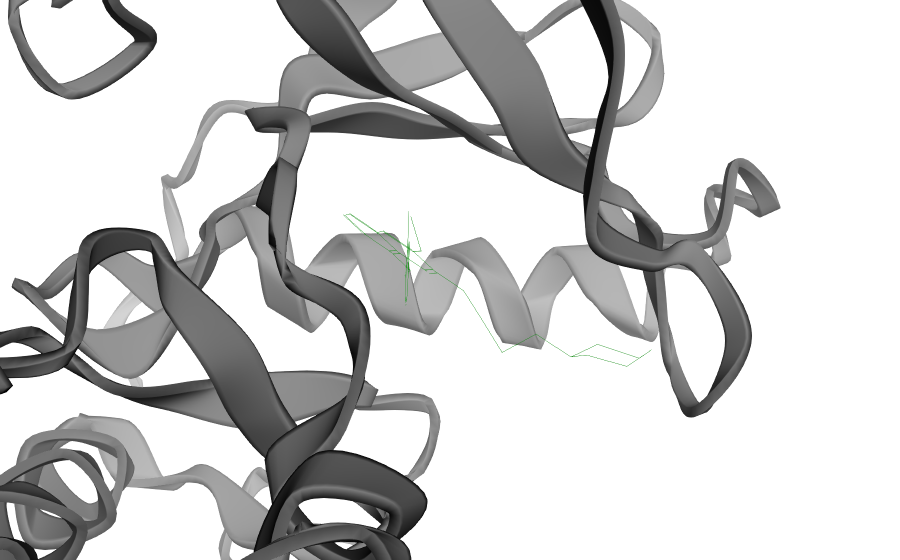
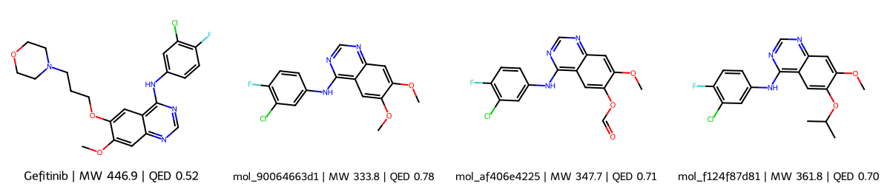
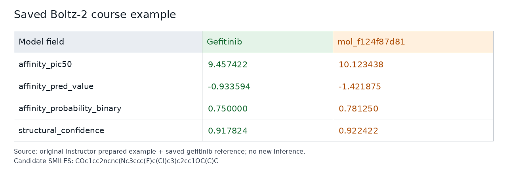
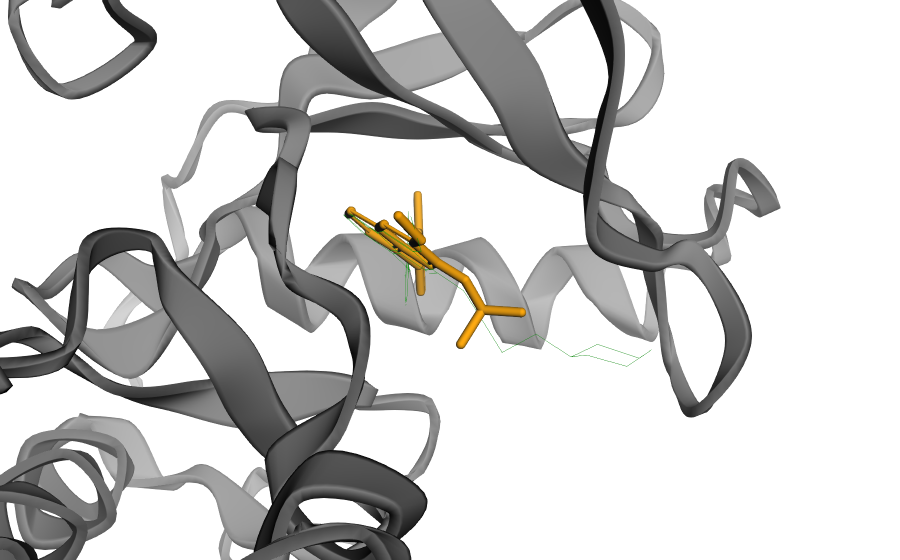

# BioNeMo Drug Discovery Run by AI Agent

<div class="bionemo-course-prompts"></div>

## Before Starting: Check GPU Resources (Workshop VM Only)

**For this workshop VM only:** the courses share one GPU. Run one GPU course at a time. The rest of the lesson can also be used in your own environment.

**Before starting:** save the previous notebook, then select **Kernel → Shut Down Kernel**. Closing the tab does not stop the kernel.

Open **File → New → Terminal** and check GPU use:

```
bootcamp-resources status
```

Before starting, confirm that no other course kernel is running. If BioNeMo is stopped, `gpu_processes` must be empty. If the GPU is busy, shut down the previous course kernel and check again. Ask the instructor if other processes remain.

**Start BioNeMo** (skip this command if all three models are already healthy):

```
bootcamp-resources start
```

Run `bootcamp-resources status` again. Wait for GenMol, DiffDock, and Boltz-2 to show **healthy**.

**Before switching to another course:** save the notebook, shut down its kernel, then stop the BioNeMo models:

```
bootcamp-resources stop --confirm
```

Check `bootcamp-resources status`. Wait until `gpu_processes` is empty before starting the next course kernel.

Details: `00_START_HERE.txt` in the workshop's main directory.

## Meet the AI Agent

**AI agents** turn natural-language instructions into actions, such as preparing data, running analyses, and displaying results. Here we use **[OpenCode](https://opencode.ai/)**, an open-source **agent harness**: software that connects a language model to tools for reading files, writing and running code, and calling the BioNeMo APIs.

Follow [Setup_OpenCode.md](Setup_OpenCode.md) to start the agent.

## AI for Virtual Screening and Lead Optimization

Drug discovery seeks molecules that act on a biological target and have suitable properties for development. **Virtual screening** ranks molecules computationally before experimental testing. **Lead optimization** modifies an active molecule to improve potency, selectivity, and other properties.

Testing every possible molecule is impractical. AI models learn from chemical and structural data to generate molecules, predict binding poses, and estimate affinity. Together, these capabilities help prioritize molecules for synthesis and testing and guide the next design cycle.

This workflow demonstrates one design-and-screening cycle with three BioNeMo NIM models:

| Model | Task | Result to inspect |
|---|---|---|
| GenMol | Generate analogues around a retained core | Molecular structures and properties |
| DiffDock | Dock selected molecules to the target protein | Binding poses and pose confidence |
| Boltz-2 | Evaluate one selected analogue | Predicted complex and affinity |

## Example: EGFR and Gefitinib

EGFR is a receptor tyrosine kinase that regulates cell growth. Activating EGFR mutations can drive non-small cell lung cancer. **Gefitinib** is an EGFR inhibitor used to treat lung cancers with sensitizing EGFR mutations, including exon 19 deletions and L858R.

Starting with gefitinib bound to the EGFR kinase domain in [PDB 2ITY](https://www.rcsb.org/structure/2ITY), generate related molecules, inspect their binding poses, and compare one analogue's predicted affinity with gefitinib.

### Setup Prompt — Install BioNeMo Agent Toolkit

**Workshop VM:** the toolkit is already installed. Skip this prompt and continue to **Prompt 1**. Use the installation prompt below when preparing your own environment.

```
Install the official NVIDIA BioNeMo Agent Toolkit from https://github.com/NVIDIA-BioNeMo/bionemo-agent-toolkit. Enable its molecule-generation, docking, and affinity-evaluation skills.

Confirm that the skills are available, then stop before running any models.
```

After a new installation, restart OpenCode to load the skills.

## 1. Retrieve the Protein and Small Molecules from Database

Retrieve EGFR and bound gefitinib from the same crystal structure to provide experimental reference coordinates.

### Prompt 1 — Retrieve EGFR and Gefitinib

```
Retrieve the EGFR–gefitinib complex from PDB 2ITY. Prepare EGFR chain A, its complete protein sequence, and bound gefitinib.

Show gefitinib's molecular structure, molecular weight, lipophilicity, and drug-likeness. Show where it binds to EGFR, using a grey protein cartoon and green gefitinib wireframe.

Provide an interactive HTML view of the complex with rotation and zoom. Save it as figures/agent/egfr_gefitinib_complex.html and link to the file. Save the inputs and images. Stop before generating new molecules.
```

<!-- representative:egfr_gefitinib_complex -->


*Example: experimental EGFR in grey and gefitinib in green. [Interactive HTML](figures/egfr_gefitinib_complex.html).*
<!-- /representative:egfr_gefitinib_complex -->

**Inspect:** Where is gefitinib located relative to the kinase domain?

## 2. Generate Small Molecule Analogues with GenMol

Request 20 molecules around a retained core. Inspect molecular weight (**MW**), lipophilicity (**cLogP**), and drug-likeness (**QED**); select up to three analogues for docking.

### Prompt 2 - Generate and Filter Molecules

```
Ask GenMol for 20 gefitinib analogues using the prepared generation settings and retaining the gefitinib-derived core.

Mark and exclude invalid molecules. Select up to three valid, unique analogues with molecular weights of 250–550 g/mol, ranked by drug-likeness. Exclude gefitinib and the unchanged core. Report the returned and selected counts. Continue with fewer than three if needed. If none qualify, explain why and wait for instructions.

Show a labeled structure grid and a table comparing the analogues with gefitinib by molecular weight, lipophilicity, and drug-likeness. Save the results and stop before docking.
```

<!-- representative:genmol_molecules -->


*Example: gefitinib and three selected analogues from the saved manual run, labeled with molecule ID, MW, and QED.*
<!-- /representative:genmol_molecules -->

**Inspect:** Which parts of gefitinib's core were preserved? Which properties would you prioritize when choosing an analogue?

## 3. Inspect Binding Poses with DiffDock

Dock gefitinib and the selected analogues into EGFR. Compare their positions and orientations in the binding pocket, then select one analogue by pose confidence.

### Prompt 3 - Dock Molecules to the Target Protein

```
Use DiffDock to dock gefitinib and the selected analogues into the experimental EGFR structure. Generate five poses per molecule and compare their best pose confidences.

Select one analogue for affinity evaluation. Show its best docking pose alongside experimental gefitinib: grey protein cartoon, green gefitinib wireframe, and orange analogue sticks.

Provide an interactive HTML view of the docked complex with rotation and zoom. Save it as figures/agent/diffdock_pose.html and link to the file. Save the poses, confidence scores, images, and selected molecule's identity. Stop before running Boltz-2.
```

<!-- representative:diffdock_pose -->


*Example: the DiffDock pose of analogue `mol_f124f87d81` in orange, with experimental gefitinib in green and EGFR in grey. [Interactive HTML](figures/diffdock_pose.html).*
<!-- /representative:diffdock_pose -->

**Inspect:** Does the analogue occupy the reference binding pocket? How does its core orientation compare with experimental gefitinib?

## 4. Evaluate with Boltz-2

Predict the complex and affinity from the EGFR sequence, supplied alignment, and selected molecule. **Run only one new candidate live.** Load gefitinib's saved reference score without another prediction.

### Prompt 4 - Evaluate Protein-Small Molecule Complex Structure

```
Evaluate ONLY that one selected analogue with Boltz-2, using the complete EGFR sequence and prepared alignment. Reuse its result if already evaluated.

Compare its predicted affinity, binding probability, and structural confidence with the saved gefitinib reference. Do not evaluate gefitinib again.

Save the full response, predicted structure, affinity comparison table, and evaluated molecule's ID and SMILES under results/agent/. Report the saved files, then stop before visualization. Do not evaluate another candidate.
```

<!-- representative:affinity_comparison -->


*Example: affinity and confidence scores for gefitinib and analogue `mol_f124f87d81`, read from the saved manual comparison table.*
<!-- /representative:affinity_comparison -->

For `affinity_pic50`, a higher value indicates stronger predicted affinity. `affinity_probability_binary` is a continuous binding probability from 0 to 1, despite its name. Keep the original output fields when reporting results.

## 5. Visualization, Interpretation, and Export

Use the results saved in Prompt 4 to visualize the complex and interpret the complete workflow.

### Considerations for Evaluating Results

Evaluation continues at every step. These considerations can help assess the results and choose follow-up work.

| Evidence | Questions and Considerations |
|---|---|
| Core, MW, cLogP, and QED | Is the core preserved? What property trade-offs appear? |
| DiffDock pose confidence | Which poses rank highest, and do they occupy the expected pocket? |
| Pose geometry and distances | Are contacts plausible and free of clashes? Do DiffDock and Boltz-2 agree? Protein Cα RMSD describes alignment, not affinity. |
| Boltz-2 structural confidence | How well supported is the complex, especially the ligand interface when scores are available? |
| `affinity_probability_binary` | How likely is binding? The returned probability ranges from 0 to 1. |
| `affinity_pic50` | How does affinity compare with gefitinib? Higher values favor stronger predicted binding. |

**Saved example — probability ≥ 0.5:** gefitinib (0.750) and the analogue (0.781) both pass this example filter. Boltz-2 evaluates one analogue against gefitinib; the other analogues have DiffDock results only.

### Prompt 5 - Visualize and Interpret Results

```
Load the selected analogue's saved Boltz-2 result and comparison table from Prompt 4. Use saved results only; do not run additional model calls.

Align the complex to experimental EGFR by superposing matching protein Cα atoms. Transform the analogue with the protein. Use the predefined viewer: grey experimental EGFR cartoon, green experimental gefitinib wireframe, and orange Boltz-2 analogue sticks.

Provide an interactive HTML view with rotation and zoom. Save figures/agent/boltz2_complex.html and figures/agent/boltz2_complex.png, and link to both files.

Print the affinity comparison table with a pass/flag column for the example binding-probability cutoff ≥ 0.5. Apply the considerations above to the current results: compare pose quality, structural confidence, predicted affinity, and molecular properties. Flag any conflicts or unavailable metrics.

Conclude with a brief recommendation and the main trade-off. Suggest next steps for prediction consistency, solubility and synthesis, and EGFR activity assays. Link to the saved structures and results, then stop.
```

<!-- representative:boltz2_complex -->


*Example: the aligned Boltz-2 pose of the same analogue in orange, with experimental gefitinib in green and EGFR in grey. [Interactive HTML](figures/boltz2_complex.html).*
<!-- /representative:boltz2_complex -->

### Conclusion and Next Steps

In the saved example, the analogue has higher predicted affinity and similar structural confidence to gefitinib, alongside higher QED and cLogP. A useful next step is to investigate its activity and solubility.

- **Prediction consistency:** compare poses and scores across independent runs after the session.
- **Molecular development:** assess solubility, selectivity, and synthetic accessibility.
- **Experimental follow-up:** compare EGFR inhibition, then cellular activity and selectivity, with gefitinib.

## Choose Prepared Results When Needed

To use a saved example for a step, paste:

```
Use the prepared example for this step. Identify its molecule and keep its structures and scores matched throughout the workflow.

Label these as prepared results. Continue from this step without rerunning the earlier models or submitting a replacement request.
```

Compare results using the actual molecule ID and SMILES.

Resources: [BioNeMo Agent Toolkit](https://github.com/NVIDIA-BioNeMo/bionemo-agent-toolkit), [Generative virtual screening blueprint](https://build.nvidia.com/nvidia/generative-virtual-screening-for-drug-discovery/blueprintcard), [Gefitinib in EGFR mutation-positive lung cancer](https://pubmed.ncbi.nlm.nih.gov/26980062/), [PDB 2ITY](https://www.rcsb.org/structure/2ITY), [GenMol API](https://docs.nvidia.com/nim/bionemo/genmol/latest/endpoints.html), [DiffDock](https://docs.nvidia.com/nim/bionemo/diffdock/latest/getting-started.html), [Boltz-2](https://docs.nvidia.com/nim/bionemo/boltz2/latest/inference.html).

Additional notebooks: [Workflow without an agent](BioNeMo_Workflow.ipynb), [NIM deployment](Setup_NIM.md), [OpenCode + RAP setup](Setup_OpenCode.md).
