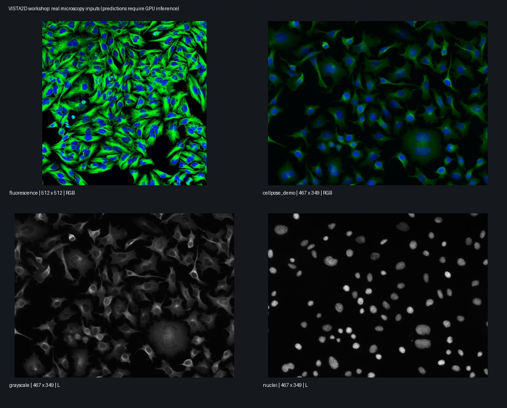

# Real Microscopy Inputs 真實顯微影像輸入

These four files contain real microscopy imagery and have been visually
inspected. No generated cell illustrations are used in the student lesson.
Downloaded bytes are preserved; source links and hashes are in assets.json.

四個檔案均為已人工檢視的真實顯微影像。學員課程不使用生成的細胞示意圖。
下載位元組原樣保存，來源與雜湊記錄於 assets.json。

## Recommended sequence 建議順序

| File 檔案 | Input 輸入 | Use 用途 |
| --- | --- | --- |
| img00.png | 512 × 512 RGB, dense green-and-blue fluorescence 密集綠藍雙色螢光 | Main demonstration and first inference 主要示範與首次推論 |
| cellpose_demo_img02.png | 467 × 349 RGB Cellpose demo 彩色 Cellpose 展示圖 | Second inference with the same model 同一模型第二次推論 |
| cyto.png | 467 × 349 grayscale cell image 灰階細胞影像 | Optional channel experiment 選做通道實驗 |
| nuclei.png | 467 × 349 grayscale nuclei 灰階細胞核影像 | Optional discussion of target definition 選做分割目標定義討論 |

The first image has many touching objects and visible intracellular structure,
making it a useful candidate for a visually engaging reveal. The second provides
a second RGB field. Nuclei-only input should remain optional: nuclei and whole
cells are different targets. These are visual selection judgments, not verified
VISTA2D performance claims. Check predictions on the classroom GPU before finalizing.

第一張有許多相鄰物件與可見細胞內結構，適合作為視覺示範候選。第二張提供不同彩色視野。
細胞核影像保留為選做，因為細胞核與完整細胞是不同目標。以上是視覺選材判斷，並非已驗證的
VISTA2D 效能結論；定稿前需在課堂 GPU 檢查預測。

## Download provenance 下載來源

- img00.png: [Cellpose MCP example image](https://github.com/surajinacademia/cellpose_mcp/blob/fa94d223cd28bb9519ba5aa950f331bbbe6d1990/poster/poster_images/img00.png).
  Its [README](https://github.com/surajinacademia/cellpose_mcp/blob/fa94d223cd28bb9519ba5aa950f331bbbe6d1990/README.md)
  identifies fluorescence with cytoplasm and nuclei. The exact original study,
  cell line, stain identities, and Cellpose dataset ID have not been established.
  原專案描述為細胞質與細胞核螢光；未確認原始研究、細胞株、染劑名稱或 Cellpose 資料集 ID。
- cyto.png: unchanged bytes of
  [img01_XY_cyto.png](https://github.com/bgruening/galaxytools/blob/b85231e12e69dfac2634ede70458182f25886fd5/tools/cellpose/test-data/img01_XY_cyto.png)
  in the Galaxy Cellpose wrapper tests. 僅更改本機檔名，內容未修改。
- nuclei.png: unchanged bytes of
  [img02_XY_nuclei.png](https://github.com/bgruening/galaxytools/blob/b85231e12e69dfac2634ede70458182f25886fd5/tools/cellpose/test-data/img02_XY_nuclei.png)
  in the same wrapper tests. 僅更改本機檔名，內容未修改。

- cellpose_demo_img02.png: unchanged bytes of the original-named
  [img02.png](https://github.com/bgruening/galaxytools/blob/81c6be8cc2502367ae52bf093b838e9764b22c00/tools/cellpose/test-data/img02.png)
  in an earlier Galaxy wrapper revision. The same example filename and official
  Cellpose URL are used in the [Omnipose multi-channel example](https://omnipose.readthedocs.io/examples/multi_channel_cyto.html).
  取自較早的 Galaxy 固定版本；Omnipose 多通道範例也使用相同檔名與 Cellpose 官方網址。

Pixel comparison confirms cyto.png is exactly this RGB image's green channel,
and nuclei.png is exactly its blue channel. These two channel variants are not
independent biological samples. No channels were synthesized or altered here.

像素比對確認 cyto.png 完全等於這張 RGB 圖的綠色通道，nuclei.png 完全等於藍色通道。
這兩個通道版本不是獨立生物樣本；本專案未生成或更改通道。

These are Cellpose-related examples from public mirrors. They have not been
verified as the exact test/001_img.png used in the VISTA bundle or as members of
the tutorial's cellpose_toy_datalist.json. We do not attach unverified ground-truth
masks or claim that these images were absent from VISTA2D training.

這些是來自公開鏡像的 Cellpose 相關範例，未確認為 VISTA bundle 的 test/001_img.png，
也未確認為教學清單的同一批影像。不附未驗證配對標註，也不宣稱模型訓練未見過這些影像。

## Closest match to the tutorial 最接近原教學的資料

The MONAI notebook uses the actual Cellpose dataset, a small datalist, SAM ViT-B
initialization, training, and single-image inference. The bundle's default input
is cellpose_dataset/test/001_img.png. For an exact tutorial-data track, obtain the
Cellpose test archive through its [official dataset page](https://www.cellpose.org/dataset),
preserve image/mask pair names, and update classroom.json. The upstream
[download guide](https://github.com/Project-MONAI/VISTA/tree/main/vista2d/download_preprocessor)
documents this manual dataset step. No email or terms form has been submitted here.

MONAI 筆記本使用真實 Cellpose 資料、小型清單、SAM 初始化、訓練與單張推論。
bundle 預設輸入為上述測試影像。若要使用完全相同資料，可從官方資料頁取得測試壓縮檔，
保留影像／遮罩配對名稱並更新 classroom.json。上游指南記錄此手動下載步驟；
本次未提交任何電子郵件或條款表單。

Cellpose's official [README](https://github.com/MouseLand/cellpose) also links
public [demo images](https://www.cellpose.org/static/images/demo_images.zip),
described as a subset of paper test images. This is a useful expansion source
without requiring the full training collection.

Cellpose 官方 README 另連結公開展示影像，描述為論文測試影像的一部分，可作為擴充來源，
不必下載完整訓練集合。

## Attribution and terms 出處與使用條件

Retain the source records with the teaching materials. The mirrors' software
licenses do not establish image licenses. Original imagery remains subject to
its owners' terms, including applicable
[HHMI Cellpose research-content terms](https://www.cellpose.org/dataset).
Do not label these images BSD/MIT merely because their wrappers use those licenses.

教材需保留來源紀錄。鏡像專案的軟體授權不等於影像授權；原始影像仍受其所有者條件規範，
包括適用的 HHMI Cellpose 研究內容條款。不可因為包裝程式採 BSD／MIT 就替影像標示相同授權。

Cellpose reference / 參考文獻: Stringer et al., *Cellpose: a generalist algorithm
for cellular segmentation*, Nature Methods (2021),
[DOI](https://doi.org/10.1038/s41592-020-01018-x).
