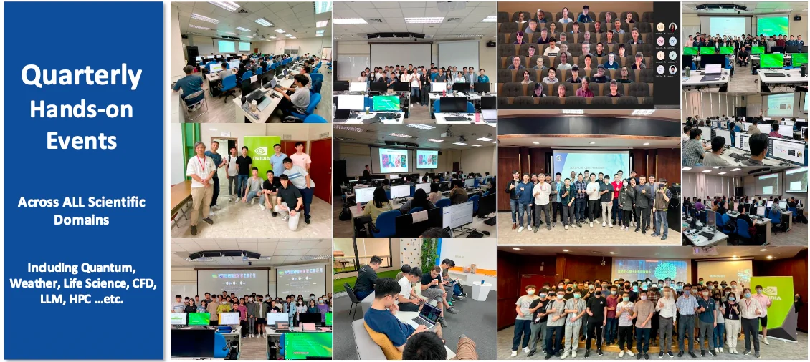
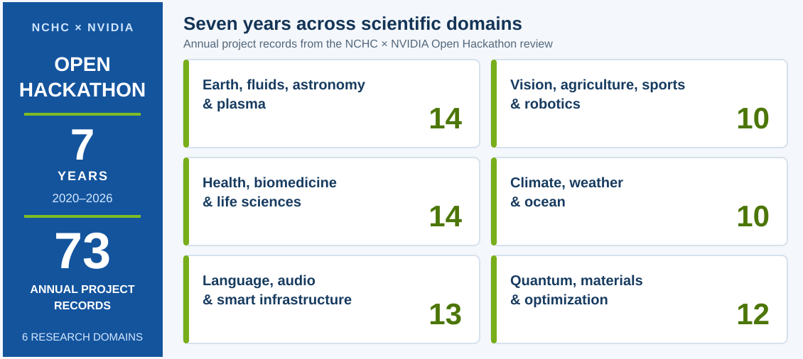
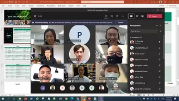
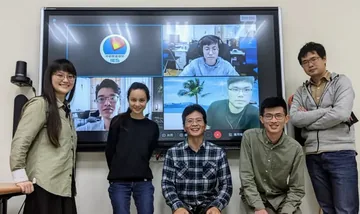
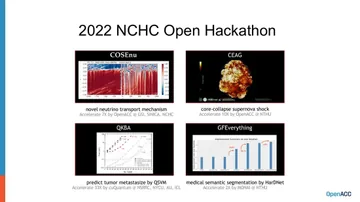
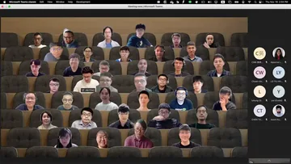
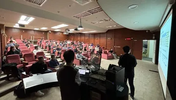
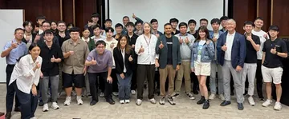
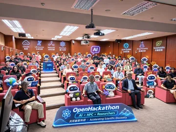

# NCHC &times; NVIDIA Joint Lab

國家高速網路與計算中心（NCHC）與 NVIDIA 透過技術交流、實作訓練營與 Open Hackathon，讓研究社群及運算資源與技術工具、導師經驗相互結合，協助不同領域的研究者將 GPU 與 AI 用於自己的研究問題。這個儲存庫整理歷年活動、課程教材及公開成果。

<!-- TOC START -->
<!-- TOC END -->

**[找 Bootcamp 教材](#bootcamp)** &middot; **[看 Hackathon 成果](#open-hackathon)** &middot; **[依領域瀏覽](EVENTS.md)**

> **第一次來？** 活動已按形式收在 [events](events/README.md)；各場仍以日期命名。找教材或成果，請從下方圖片與[分類索引](EVENTS.md)開始。

## Bootcamp

<!-- toc-name: Bootcamp -->
<!-- toc-order: 1 -->

[](EVENTS.md)

從技術介紹走到動手實作，活動頁可能提供投影片、Notebook、環境建置說明與錄影，供學員課後繼續練習。近期教材包括：[數位生醫：BioNeMo、細胞影像與單細胞分析](events/bootcamps/20261110/README.md)，以及[量子運算：CUDA-Q Agentic Coding](events/bootcamps/20260807/README.md)。您可以[依領域找更多課程](#依領域找教材)。

## Open Hackathon

<!-- toc-name: Hackathon -->
<!-- toc-order: 1 -->

[](events/hackathons/20261104/NCHC-NVIDIA-7year-OpenHackathon-Review.pdf)

七年活動影像（點選縮圖查看當年活動；2020&ndash;2022 年連至[七年回顧](events/hackathons/20261104/NCHC-NVIDIA-7year-OpenHackathon-Review.pdf)）：

| 2020 | 2021 | 2022 | 2023 |
| :--: | :--: | :--: | :--: |
| [](events/hackathons/20261104/NCHC-NVIDIA-7year-OpenHackathon-Review.pdf) | [](events/hackathons/20261104/NCHC-NVIDIA-7year-OpenHackathon-Review.pdf) | [](events/hackathons/20261104/NCHC-NVIDIA-7year-OpenHackathon-Review.pdf) | [](events/hackathons/20231207/README.md) |
| **2024** | **2025** | **2026** | [**完整回顧**](events/hackathons/20261104/NCHC-NVIDIA-7year-OpenHackathon-Review.pdf) |
| [](events/hackathons/20241204/README.md) | [](events/hackathons/20251112/README.md) | [](events/hackathons/20261104/README.md) | [七年成果 PDF](events/hackathons/20261104/NCHC-NVIDIA-7year-OpenHackathon-Review.pdf) |

研究團隊帶著自己的題目，與導師共同移植、分析及優化程式。[七年回顧](events/hackathons/20261104/NCHC-NVIDIA-7year-OpenHackathon-Review.pdf)整理了 **2020&ndash;2026 年、73 筆年度科研專案紀錄、六大研究領域**；[2026 年活動頁](events/hackathons/20261104/README.md)另有 16 隊成果表與期末報告。例如 MFC 團隊在相同的 8&times;H200 上，將完整模擬時間由 280.6 秒縮至 87.5 秒（3.21 倍）。[閱讀歷年 Hackathon 成果](EVENTS.md#hackathon)。

此外也收錄技術分享、Workshop 與跨機構合作活動。各場活動的主辦單位、教材與公開內容，以個別活動頁為準。

## 依領域找教材

<!-- toc-name: 依領域找教材 -->
<!-- toc-order: 1 -->

| 領域 | 從這裡開始 |
| ---- | ---------- |
| HPC/GPU 加速 | [N-Way、Grace、GPU 程式設計](EVENTS.md#hpc) |
| AI for Science / 物理與氣象 | [PhysicsNeMo、PINN、Earth-2](EVENTS.md#ai-for-science) |
| LLM/Agentic AI | [NeMo、推論、Agentic AI](EVENTS.md#llm) |
| 量子運算 | [CUDA-Q、cuQuantum、量子模擬](EVENTS.md#quantum) |
| 數位生醫 | [BioNeMo、醫學影像、基因體與單細胞](EVENTS.md#digital-biology) |
| 跨領域技術交流 | [技術分享、HiPAC 等活動](EVENTS.md#tech-sharing) |

Hackathon 同時涵蓋多個領域，請另見[歷年隊伍成果](EVENTS.md#hackathon)。也可從[完整活動索引](EVENTS.md)按日期查找；NVIDIA 線上課程另見 [tutorials](tutorials/README.md)。

## 只取得需要的活動教材

不必下載整個儲存庫。先以局部方式複製，再指定想要的**活動路徑**（以下以 2026/11/10 數位生醫訓練營為例）：

``` bash
git clone --filter=blob:none --sparse --depth 1 https://github.com/nqobu/nvidia.git
git -C nvidia sparse-checkout set events/bootcamps/20261110
```

要再加入另一場活動，例如 2026/08/07 的量子訓練營：

``` bash
git -C nvidia sparse-checkout add events/bootcamps/20260807
```

每個活動的完整路徑都列在[活動索引](EVENTS.md)。這種方式會取得所選活動目錄的全部檔案，也會保留儲存庫根目錄及路徑上層的檔案；若只需要單一 PDF 或 Notebook，直接從活動頁點選該檔案即可。

> [!NOTE]
> DO NOT add issues, discussion, or files to this repo.

<!--
  vim:  ft=markdown ic noet norl wrap ts=8 sts=8 sw=8:
  -->
